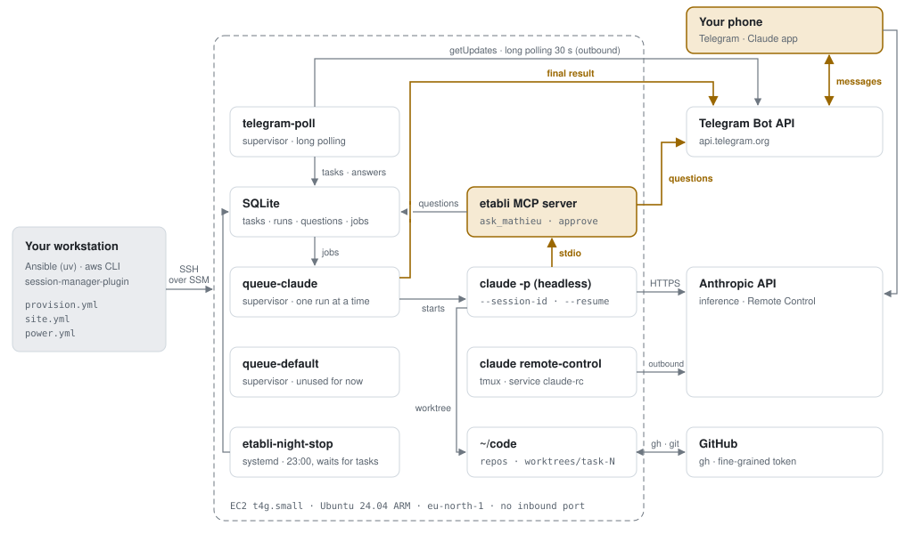

# Établi

An EC2 instance that runs Claude Code headless on your repos, driven from Telegram. You start a task with `/tache`, Claude works on its own in a worktree, and when a decision is yours to make it asks you on Telegram. Your answer resumes the session where it stopped.



The machine has no inbound port: the bot polls Telegram with long polling, Claude Code and Remote Control open outbound connections, and your workstation goes through SSH tunneled over SSM.

## Flows

### Starting a task

`/tache <project> <instructions>` sent to the bot:

1. `telegram-poll` receives the message. Only the Telegram id in `TELEGRAM_USER_ID` is listened to.
2. The project is looked up in `~/code`. If it is not there, it is cloned with `gh repo clone` (bare name or `owner/name`). If it does not exist on GitHub either, the bot offers to create an empty local project, with two buttons, so that a typo creates nothing.
3. The task is stored in SQLite and a `RunClaudeTask` job goes onto the `claude` queue.

### A run

`queue-claude` processes runs one at a time, and never retries a failed run:

1. A worktree `~/code/worktrees/task-N`, on branch `etabli/task-N`, is created if it does not exist. It is kept as long as the session can be resumed.
2. `claude -p` starts in that worktree with `--session-id`, the task's `allowedTools`, the `etabli` MCP server only (`--strict-mcp-config`) and the prompt `laravel/prompts/headless.md`.
3. The JSON stream is written to `storage/logs/runs/<run>.jsonl`. Its last event gives the run's cost and number of turns.
4. The final status is decided as follows: an unanswered question wins, otherwise the task is `done` or `failed`.

### A question: `ask_mathieu`

When a decision is yours (design choice, irreversible action, real ambiguity), Claude calls the `ask_mathieu` MCP tool with the question and two to four options:

1. The MCP server, started by `claude -p` over stdio, stores the question and sends it to Telegram right away. Sending is synchronous: through the queue, it would wait behind the current run.
2. Claude is told to stop, the run ends and the task moves to `waiting_input`.
3. You answer with a button, by replying to the question's message, or with free text if only one question is pending.
4. `ResumeClaudeTask` resumes the session with `--resume`, in the same worktree, with your answer as the prompt.

### A permission: `approve`

A tool outside the `allowedTools` goes through `--permission-prompt-tool mcp__etabli__approve`:

- Read-only use is allowed automatically: `Glob`, `Grep`, and `ls`, `cat`, `grep`… without shell operators (`find` only without `-exec` or `-delete`).
- Everything else becomes an **Autoriser / Refuser** (allow / deny) question on Telegram. The tool is denied for this run, Claude stops, and the task moves to `waiting_permission`.
- **Autoriser** adds the exact rule (for example `Bash(make test)`) to the task's `allowedTools`, then resumes it. Any other text counts as a denial, and that text is passed on to Claude as an explanation.

### End of a task

The result is sent to Telegram, whether the task is `done` or `failed`. Replying to that message resumes the session with your reply: that is how you ask for a fix or for what comes next.

```
queued → running → done | failed
            ↓
  waiting_input | waiting_permission → (your answer) → queued → running …
```

### Remote Control

Alongside tasks, `claude remote-control` runs in tmux (service `claude-rc`) to open an interactive session on the machine from the Claude app. It is independent of tasks and of Telegram.

### Power and deployment

Everything goes through Ansible from your workstation: `provision.yml` creates the AWS infrastructure, `site.yml` configures the machine and deploys the app, `power.yml` starts or stops the instance. Every night at 23:00, `etabli-night-stop` shuts the machine down, after first waiting until no task is `queued` or `running`.

## The repo

- `ansible/`: the EC2 infrastructure and configuration. Step-by-step setup is in [ansible/README.md](ansible/README.md) (in French).
- `laravel/`: the app. The bot (`TelegramPoll`, `TelegramUpdateHandler`), the jobs (`RunClaudeTask`, `ResumeClaudeTask`) and the MCP server (`app/Mcp`).
